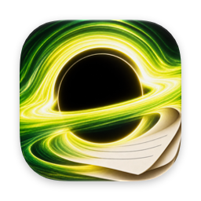
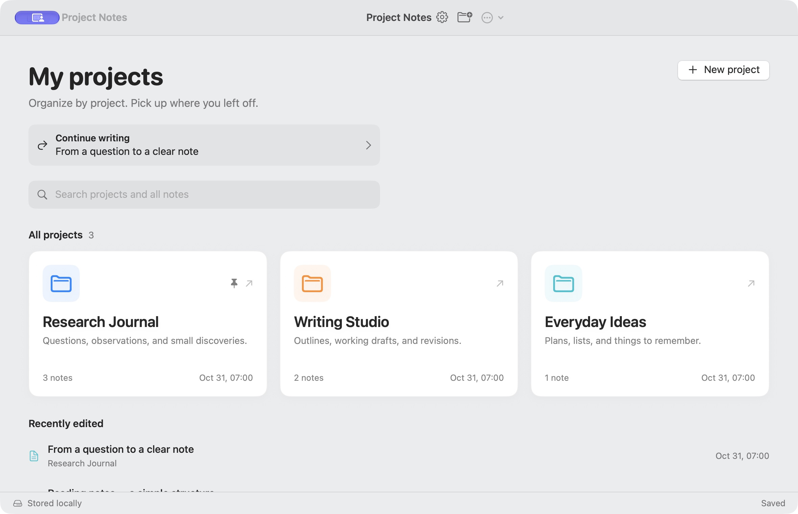
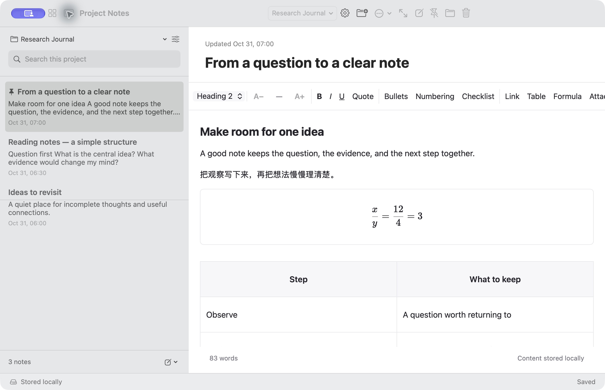
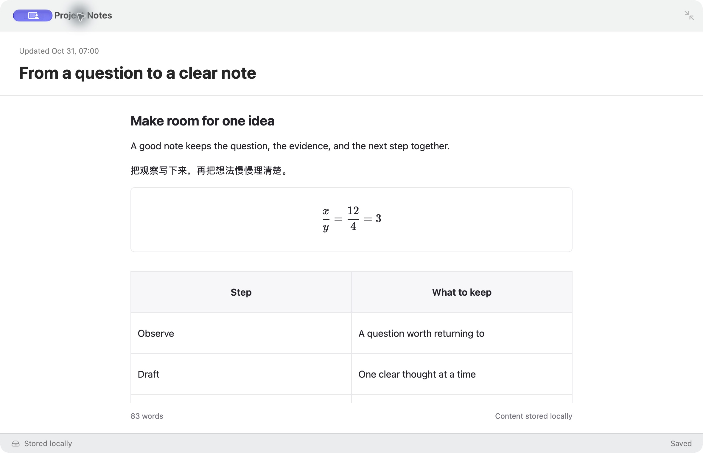
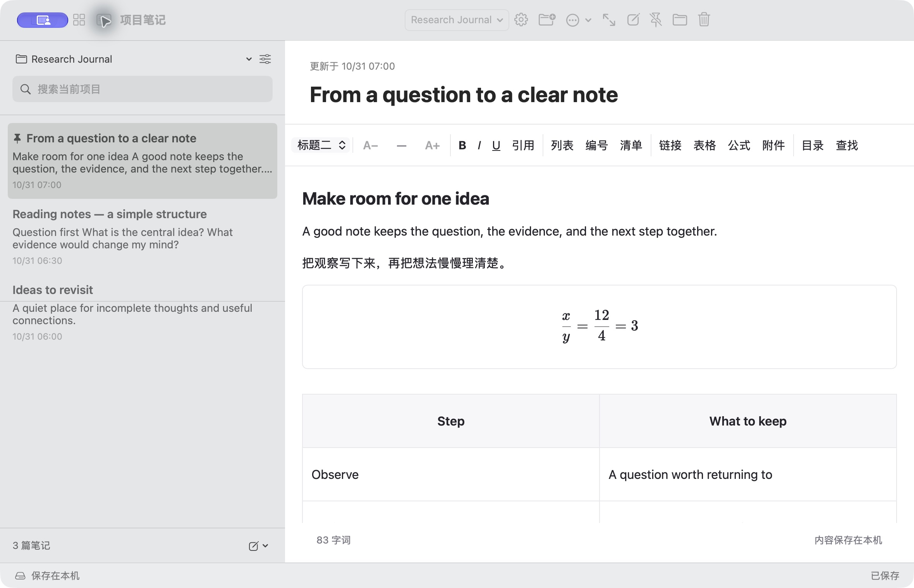

<h1 align="center">ProjectNotes</h1>

<strong>A native Mac notebook that starts with your projects.</strong>

Keep related notes together, return to your last thought, and make room for longer writing.

  <a href="https://github.com/B0yangWong/ProjectNotes-Releases/releases/download/v0.6.1/ProjectNotes-0.6.1-macOS-universal.zip">Download for Mac</a> |
  <a href="#features">Features</a> |
  <a href="INSTALL.md">Installation</a> |
  <a href="PRIVACY.md">Privacy</a> |
  <a href="README.zh-CN.md">中文说明</a>

---

Open a project, choose a note, and keep writing. ProjectNotes combines a project home, a rich-text editor, and local backups in a quiet macOS workspace. There is no app account, subscription, or cloud service to configure.

This repository hosts the downloadable app, documentation, and synthetic demo images. Application source code remains private. **Download the app ZIP in Releases; GitHub's automatically generated “Source code” archives contain this documentation, not the application.**

**0.6.1 preview · macOS 14 minimum build target · Universal (Apple silicon + Intel).** The Apple silicon build has been checked on the development Mac; Intel hardware, older macOS versions, and a separate clean-Mac first install have not been tested. The app is ad-hoc signed, without Developer ID signing or Apple notarization. macOS may block the first launch; read [Install and Open](INSTALL.md).

## Features

| Feature | What you can do |
| --- | --- |
| Projects first | Organize notes into projects, search across them, and pin the ones you use most. |
| Continue writing | Open the last edited note, browse the five most recent notes, and restore your cursor and reading position. |
| Rich text | Use headings, bold, italic, lists, checklists, tables, and links. Change the size of selected text without changing the interface. |
| Math and attachments | Insert editable formulas, local images, and PDF attachments. Simple slash fractions render as stacked fractions. |
| Search and outline | Find text with yellow highlights and move through a note's headings. |
| Focus mode | Hide the note list and formatting tools with one button or `Command + Shift + Return`. |
| MacBook-sized windows | Work in windows down to 640 × 500. Below 900 points wide, the note list opens in a temporary panel. |
| Local saving | See pending, saving, saved, or failed status. Normal note switches and quit wait for the latest content to save. |
| Automatic backups | Back up changed data every 15 minutes, retain the latest 20 backups, and restore a note with its attachments as a new copy. Choose another disk in Settings. |
| Reading PDFs | Export paginated A4 PDFs with text, formatting, formulas, and images. PDF attachments are listed by filename. |
| English and Chinese | Choose the interface language and interface size in Settings. |

## Preview

These are screenshots of the actual 0.6.1 download build using an isolated library with invented projects and writing samples. They contain no personal notes. Example content is not included in a fresh installation.

Focus mode and Chinese interface

## Install and Open

1. Download [ProjectNotes-0.6.1-macOS-universal.zip](https://github.com/B0yangWong/ProjectNotes-Releases/releases/download/v0.6.1/ProjectNotes-0.6.1-macOS-universal.zip) from the [0.6.1 release](https://github.com/B0yangWong/ProjectNotes-Releases/releases/tag/v0.6.1).
2. Unzip it and move `ProjectNotes.app` into Applications. No Xcode, Node.js, browser server, or additional runtime is required.
3. Open the app. If macOS blocks an unverified developer, review the download and decide whether to trust it. Use only the manual exception described in [Apple's instructions](https://support.apple.com/en-us/102445). If the warning says the app will harm your computer or is damaged, stop and report it. Do not disable system security checks or run a quarantine-removal command.
4. Create a project and add a note. The interface initially uses Chinese; choose **设置 / Settings → 语言 / Language → English** if preferred.

`SHA256SUMS.txt` accompanies the release for checking download integrity. It does not verify publisher identity or imply Apple approval. See [Installation and Compatibility](INSTALL.md) for details.

## Everyday Controls

| Action | Shortcut |
| --- | --- |
| New project | `Command + Shift + N` |
| New note in the current project | `Command + N` |
| Project home | `Command + Shift + H` |
| Show / hide note list | `Command + Control + S` |
| Enter / leave focus mode | `Command + Shift + Return` |
| Find in the note | `Command + F` while editing |
| Increase / decrease selected text size | `Command + Plus` / `Command + Minus` |
| Reset selected text size | `Command + 0` |
| Export PDF | `Command + Shift + E` |
| Settings | `Command + Comma` |

Text-size commands require selected body text. Interface size is a separate setting. Escape closes search or a dialog before leaving focus mode; Chinese input composition is preserved. Deleting a selected note from the list asks for confirmation and moves it to Recently Deleted.

## Your Data Stays on Your Mac

Notes, attachments, reading positions, and default backups are stored locally in `~/Library/Application Support/ProjectNotes/`. Nothing is uploaded to this repository by the app. There is no account, advertising, analytics upload, cloud sync, or automatic update check. Links open in your browser only when you activate them. See [Privacy](PRIVACY.md).

Updates are manual: back up your library, quit normally, then replace the app without deleting its data folder. Local backups help recover mistakes, but backups on the same disk do not protect against losing that disk. Data and backups are not independently encrypted by the app.

## Current Limits and Feedback

PDF copying can vary by reader, including missing repeated letters in an extracted word. Native macOS display was checked; verify copied text and read the [PDF validation limits](VALIDATION.md#remaining-limits).

ProjectNotes is a preview for local Mac use. It does not include iCloud sync, an iPhone app, collaboration, handwriting, scanning, PDF annotation, or Apple Notes import. Search covers note titles and text, not image or PDF contents. Formula support follows KaTeX; arbitrary plain-text expressions are not a general math parser. See [Validation](VALIDATION.md) for what has and has not been checked.

For [bug reports and feature requests](https://github.com/B0yangWong/ProjectNotes-Releases/issues/new/choose), include your app version, macOS version, and steps using invented content. Issues are public: do not attach a real library, backups, private note text, credentials, or screenshots showing personal information. Read [Security](SECURITY.md) before reporting a vulnerability.

The app is free to download and run on your own Mac. This repository does not grant an open-source license to the application or icon. See [Usage](USAGE.md), [Third-party notices](THIRD_PARTY_NOTICES.txt), and [Changelog](CHANGELOG.md).
