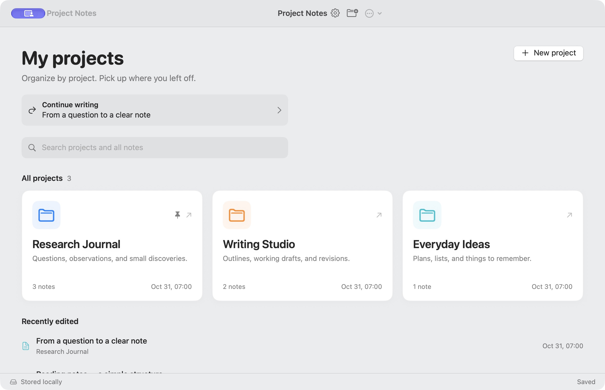
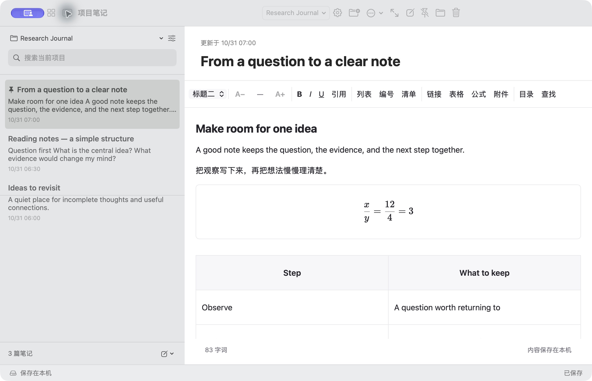
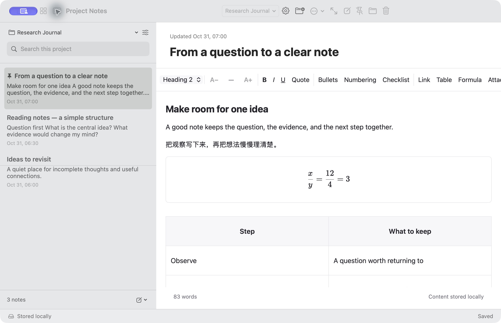
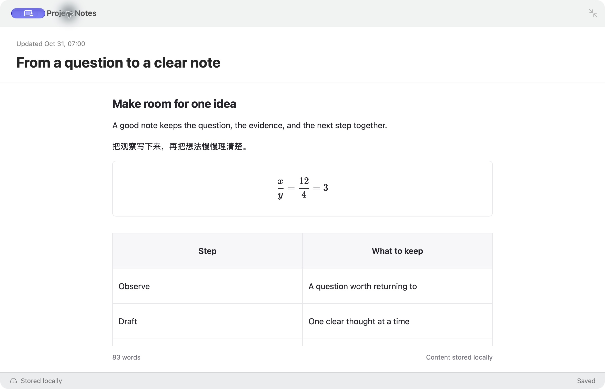

<h1 align="center">项目笔记 · ProjectNotes</h1>

<strong>从项目开始，把相关的笔记放在一起。</strong>

打开项目，接着上次的位置写；需要安静时，一键进入专注模式。

  <a href="https://github.com/B0yangWong/ProjectNotes-Releases/releases/download/v0.6.2/ProjectNotes-0.6.2-macOS-universal.zip">下载 Mac 版</a> |
  <a href="INSTALL.md">安装说明</a> |
  <a href="PRIVACY.md">隐私说明</a> |
  <a href="README.md">English</a>

---

项目笔记是一款原生 macOS 笔记应用。首页按项目分类，项目内直接新建和编辑笔记，支持富文本、公式、表格、图片、本地备份与 PDF 导出。无需注册账户或配置云端服务。

本仓库只提供应用下载、使用文档和虚构示例截图，**不公开应用源码**。请下载 Releases 中的应用 ZIP；GitHub 自动生成的“Source code”压缩包只是本仓库的文档，不是安装包。

**0.6.2 预览版：最低构建目标为 macOS 14，通用安装包包含 Apple 芯片与 Intel 架构。** 已在开发用 Apple 芯片 Mac 上检查；Intel 真机、较旧的 macOS 和另一台全新 Mac 的首次安装尚未实测。应用采用临时本地签名，没有 Apple 开发者身份签名或公证，首次打开可能被系统拦截，详见[安装说明](INSTALL.md)。

## 主要功能

| 功能 | 使用方式 |
| --- | --- |
| 按项目组织 | 用项目分类笔记，搜索标题和正文，置顶常用内容。 |
| 方便续写 | 首页显示继续上次编辑和最近 5 篇笔记；记住每篇笔记的光标和阅读位置。 |
| 富文本编辑 | 标题、加粗、斜体、列表、清单、表格和链接；字号按钮只改变选中的正文。 |
| 公式与附件 | 编辑数学公式，插入本机图片和 PDF 附件；简单斜杠分数显示为上下分式。 |
| 查找与目录 | 正文匹配内容黄色高亮，通过标题目录跳转。 |
| 专注模式 | 一键收起列表和排版工具栏，保留正文、统计和保存状态。 |
| 小窗口适配 | 窗口最低支持 640 × 500；宽度不足 900 时，笔记列表通过临时面板打开。 |
| 本地保存 | 区分待保存、正在保存、已保存和保存失败；正常切换和退出前等待保存。 |
| 自动备份 | 有改动时每 15 分钟备份，保留最近 20 份；可改到其他磁盘，恢复某篇笔记及附件为新副本。 |
| PDF 导出 | A4 白底自动分页，保留正文格式、公式和图片；PDF 附件只列文件名。 |
| 中英文界面 | 设置中切换中文或 English，界面大小单独调整。 |

## 界面预览

截图来自实际的 0.6.1 应用界面（0.6.2 布局未改动），使用独立资料库和虚构项目、示例文字，不含私人笔记。新安装的应用不附带这些示例。

英文界面与专注模式

## 安装与开始使用

1. 从[版本发布页](https://github.com/B0yangWong/ProjectNotes-Releases/releases/tag/v0.6.2)下载 `ProjectNotes-0.6.2-macOS-universal.zip`。
2. 解压，将 `ProjectNotes.app` 拖入“应用程序”。无需安装 Xcode、Node.js 或其他运行环境。
3. 打开应用。如果 macOS 提示开发者无法验证，请先确认下载来源和是否信任，再按 [Apple 官方说明](https://support.apple.com/zh-cn/102445)在系统设置中手动允许。若系统提示会损害电脑或文件已损坏，请停止打开并反馈；不要关闭系统安全检查或运行移除隔离标记的命令。
4. 新建项目，再新建笔记。默认界面为中文，可在“设置 → 语言”切换 English。

发布页同时提供 `SHA256SUMS.txt`，用于检查下载是否损坏；校验值一致不代表经过 Apple 审核或验证了发布者身份。

## 常用快捷键

| 操作 | 快捷键 |
| --- | --- |
| 新建项目 | `Command + Shift + N` |
| 当前项目新建笔记 | `Command + N` |
| 返回项目首页 | `Command + Shift + H` |
| 展开 / 收起列表 | `Command + Control + S` |
| 进入 / 退出专注 | `Command + Shift + Return` |
| 正文查找 | 编辑时按 `Command + F` |
| 放大 / 缩小选中文字 | `Command + 加号` / `Command + 减号` |
| 选区恢复默认字号 | `Command + 0` |
| 导出 PDF | `Command + Shift + E` |
| 设置 | `Command + 逗号` |

字号操作需要先选中正文；界面大小由设置单独调整。Escape 先关闭查找或弹窗，再退出专注，不打断中文选词。在笔记列表中选中笔记后按 Delete，会先确认，再移入“最近删除”。

## 数据与隐私

笔记、附件、阅读位置和默认备份保存在本机 `~/Library/Application Support/ProjectNotes/`，应用不会将它们上传到 GitHub。没有广告、统计上传、云同步或自动检查更新。点击外部链接时才交给浏览器打开，详见[隐私说明](PRIVACY.md)。

更新时先备份、正常退出，再替换应用，不要删除资料库目录。同一磁盘上的备份不能防止整块磁盘丢失或损坏；应用不单独加密笔记和备份。

本版尚不支持 iCloud、iPhone、协作、手写、扫描、PDF 批注或苹果备忘录导入。搜索不识别图片和 PDF 内文；公式受 KaTeX 语法范围限制。PDF 原生显示已检查，但不同阅读器的文字提取可能丢失重复字母，复制结果需要核对。真实兼容性和验证范围见 [VALIDATION.md](VALIDATION.md)。

可在 [Issues](https://github.com/B0yangWong/ProjectNotes-Releases/issues/new/choose)反馈问题和功能建议。公开反馈请使用虚构内容，不要上传真实资料库、备份、私人笔记、密钥或带个人信息的截图。安全漏洞请先阅读 [SECURITY.md](SECURITY.md)。

应用可免费下载并在自己的 Mac 上运行，但不因此开放应用或图标版权。详见[使用范围](USAGE.md)、[第三方许可](THIRD_PARTY_NOTICES.txt)和[更新记录](CHANGELOG.md)。
